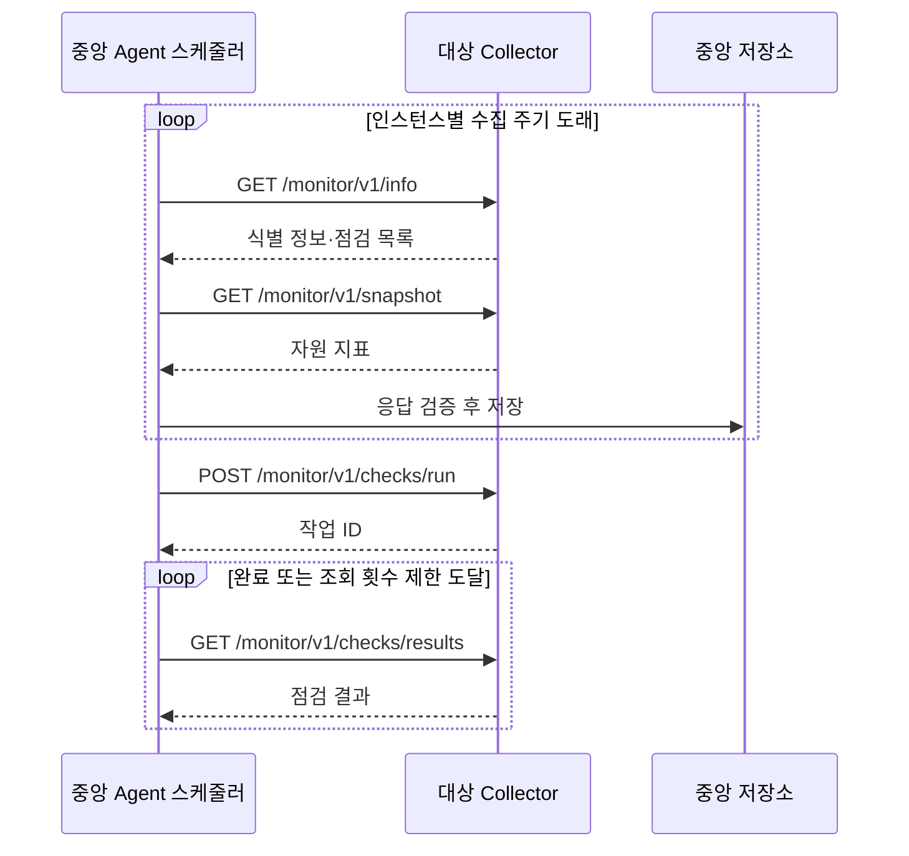
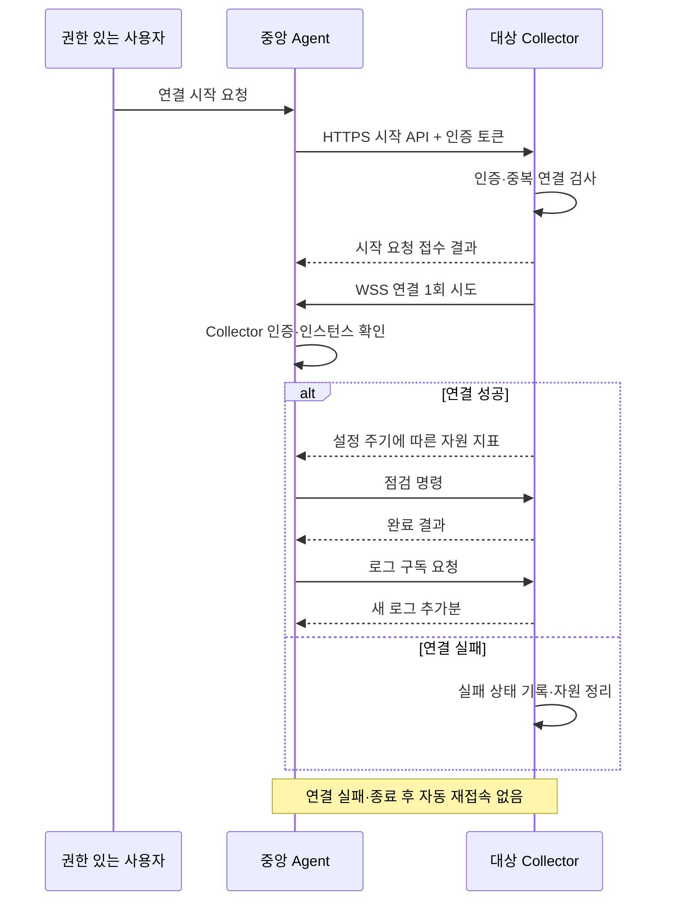
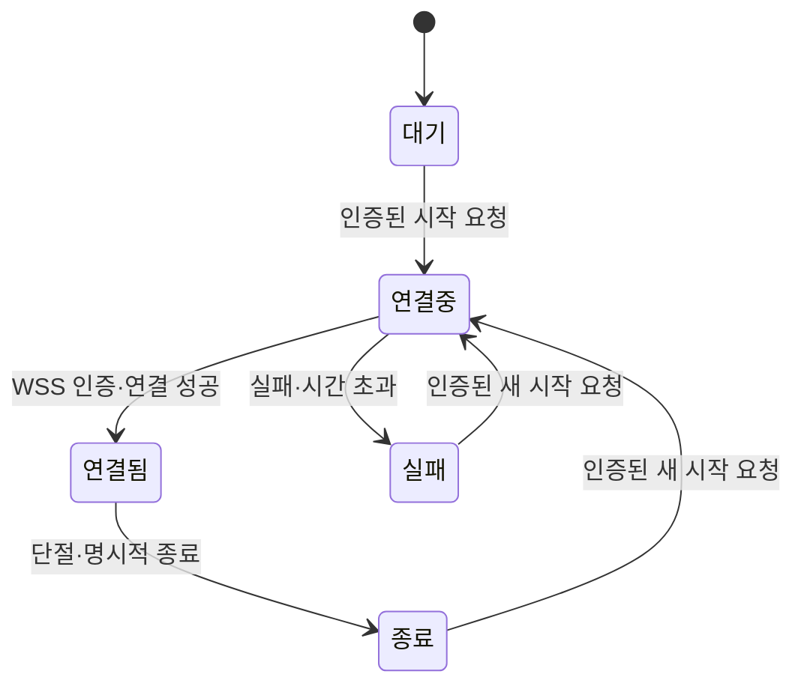

# 레거시 WAS 모니터링의 반복 HTTP 조회를 요청 기반 WSS 연결로 개선

> 작성 상태: 요청 기반 WebSocket 구현 및 로컬 기능 검증 완료. 운영 WSS·실제 Java 7 WAS·성능 비교 검증은 미완료.
> 이 문서는 공개용 초안이다. 회사명, 실제 서버 주소, 인증 정보, 운영 로그를 포함하지 않는다.
> 구현 근거와 검증 범위는 [검증 기록](collector-wss-verification.md)에 정리한다. 미측정 성능 개선율을 기재하지 않는다.

## 1. 프로젝트 개요

서로 다른 Java 웹 애플리케이션의 자원 사용량, 내부 점검, 외부 API 상태와 로그를 한곳에서 확인하는 모니터링 프로젝트다.

중앙 서버는 **Agent**, 대상 WAS 안에 배포하는 수집 JAR은 **Collector**로 부른다. 일반적인 APM 제품과 명칭이 다를 수 있으므로 이 문서에서는 이 기준을 사용한다.

| 구성 요소 | 역할 |
|---|---|
| 중앙 Agent | 프로젝트·인스턴스 등록, 수집 결과 저장, 점검 요청, 대시보드 제공 |
| Collector JAR | 대상 WAS 내부의 자원·점검 정보 제공, 제한된 로그 조회 |
| 프로젝트 연동 코드 | 프로젝트 고유 서비스·SDK·배치 상태를 공통 점검 규격에 연결 |

현재 중앙 Agent는 Java 21, Collector는 Java 7 호환을 기준으로 구성한다. 기존 업무 시스템에 별도 프로세스를 설치하기보다 WAS 라이브러리로 적용하는 배포 방식을 유지한다.

## 2. 문제: 중앙의 반복 요청에 의존하는 수집 구조

### 2.1 개선 전 동작

자원 수집 스케줄러는 실행 완료 후 15초 간격으로 수집할 인스턴스를 확인한다. 대상 서버의 실제 수집 주기는 DB의 `poll_interval_seconds`로 결정된다. ‘모든 대상 서버를 15초마다 조회한다’는 구조가 아니다.

수집 대상이 선택되면 `info`와 `snapshot`을 순서대로 조회한다. 현재 HTTP 클라이언트는 각 요청에서 소켓을 생성하고 응답 처리 후 종료하며, 요청 헤더에도 `Connection: close`를 사용한다. HTTPS 요청에서는 TLS 연결 과정도 수행한다.

API·내부 점검은 실행 요청 후 작업 ID로 결과를 반복 조회한다. 로그 조회도 별도의 HTTP 요청으로 수행한다. 따라서 자원 수집 요청 외에 점검 결과 조회와 로그 조회 요청이 추가된다.

### 2.2 해결하려는 문제

1. **수집 주기와 대상 수에 따라 HTTP 요청이 누적된다.**
   작은 지표를 가져오는 작업에도 요청과 연결 생성이 반복된다.
2. **점검 실행과 완료 결과 전달이 분리돼 있다.**
   아직 완료되지 않은 작업의 상태를 확인하기 위해 추가 조회가 필요하다.
3. **실시간 로그를 짧은 간격으로 조회하면 요청 수가 더 늘어난다.**
   변경이 없는 구간에도 조회 요청이 발생할 수 있다.
4. **프로젝트별 연동 코드에 공통 통신 책임이 섞이면 유지보수가 어려워진다.**
   연결 처리와 장애 대응을 프로젝트마다 수정하는 구조를 피할 필요가 있다.

반복 요청이 웹 보안 장비의 제한에 걸릴 가능성은 설계상 고려사항이다. 현재 모니터링이 실제로 차단됐다는 증거는 확보하지 않았으므로 ‘차단 장애를 해결했다’고 표현하지 않는다. 별도 크롤링의 차단 경험을 모니터링 장애의 증거로 사용하지 않는다.

또한 기존 구조에도 응답 크기·시간 제한, 인스턴스 중복 실행 방지와 수집 대기열 제한이 존재한다. 개선 전 시스템을 ‘아무 제한 없이 요청하는 구조’로 설명하지 않는다.

## 3. 해결: 인증된 시작 요청으로만 연결하는 WSS 구조

### 3.1 선택한 방식

중앙 Agent가 대상 Collector의 HTTPS 연결 시작 API를 호출한다. Collector는 요청을 인증한 뒤 설정된 중앙 주소로 WSS 연결을 **1회만 시도**한다. 연결 이후에는 그 연결로 수집 데이터와 점검 명령을 주고받는다.

시작 API는 `POST /monitor/v1/connection/start`이며, 인증 헤더와 30초 유효한 일회용 ticket을 사용한다. 중앙 수신 경로는 `/collector/connect`다. 시작 요청의 접수와 연결 성공은 서로 다른 상태다. API가 요청을 접수했다고 대시보드에서 바로 ‘연결됨’으로 표시하지 않는다.

### 3.2 연결 정책

| 상황 | 동작 |
|---|---|
| WAS 시작·재기동 | 연결하지 않고 대기 |
| 유효한 시작 API 요청 | WSS 연결 1회 시도 |
| 인증 실패 | 연결 시도 없이 요청 거부 |
| 이미 연결 중·연결됨 | 추가 연결을 만들지 않음 |
| 연결 시도 시간 초과·실패 | 시도 종료 및 자원 정리, 재시도 없음 |
| 연결 유지 중 단절 | 연결·전송 대기 데이터 정리, 재시도 없음 |
| 중앙 Agent 재시작 | 기존 연결 상태를 그대로 신뢰하지 않음, 대상에 자동 시작 요청하지 않음 |
| 사용자가 다시 연결 시작 | 인증된 새 요청으로만 1회 시도 |

‘자동 재접속 없음’은 WAS 내부 타이머뿐 아니라 중앙의 복구 작업과 WebSocket 라이브러리의 자동 재접속 기능에도 적용한다. 연결 확인용 Ping/Pong은 살아 있는 연결을 확인하는 용도이며 새 연결 시도와 구분한다.

### 3.3 상태 전이

중앙에는 마지막 데이터 수신 시각과 연결 종료 사유를 표시한다. 연결이 끊긴 상태를 ‘대상 업무 서버 장애’와 동일하게 판정하지 않고 ‘모니터링 연결 끊김’으로 구분한다.

## 4. 설계 판단과 대안 비교

| 대안 | 장점 | 이번 요구사항에서의 판단 |
|---|---|---|
| 기존 HTTP 폴링 | 단순한 요청·응답, 기존 배포 경로 활용 | 연결 생성과 결과 조회 요청이 반복됨 |
| HTTPS 배치 푸시 | 일반 HTTPS로 지표 전송 가능 | 중앙의 즉시 명령 전달에는 별도 구조 필요 |
| SSE | 일반 HTTP 응답으로 지속적인 데이터 수신 | 단방향 전송, 명령 전달에는 별도 요청 필요 |
| 자동 연결·자동 재접속 WSS | 중앙 복구 후 자동 연결 가능 | 요청할 때만 연결한다는 정책과 맞지 않음 |
| 요청 기반 WSS | 같은 연결로 명령·결과 전달, 연결 시점 통제 | 연결 상태·인증·자원 제한을 직접 관리해야 함 |

WSS 선택 이유는 이름이나 기술의 최신성보다 **점검 명령과 결과를 같은 연결로 전달하고, 연결 시작을 명시적으로 통제하기 위해서**다.

단, 대상 서버에서 중앙 Agent의 WSS 목적지로 나가는 통신이 실제로 허용돼야 한다. 중앙 앞단의 프록시도 WebSocket 연결을 지원해야 한다. 기존 HTTPS API 통신 성공만으로 임의 목적지의 WSS 접속을 보장할 수 없다. 기존 허용 범위에서의 연결 검증을 구현 전 선행 조건으로 둔다.

## 5. 대상 서버의 Java 수정 최소화와 공통 규격

### 5.1 책임 분리

| 구분 | 포함할 기능 | 프로젝트 적용 방법 |
|---|---|---|
| 공통 Collector JAR | 자원 수집, 인증, 시작 API, WSS 통신, 명령 분배, 로그 읽기, 종료 처리 | 검증된 공통 JAR 배포 |
| 공통 설정 파일 | 프로젝트·인스턴스 ID, 토큰, 중앙 WSS 주소, 디스크·로그 경로, 기능 사용 여부 | 동일한 키 규격으로 설정 |
| 프로젝트 연동 코드 | 고유 외부 서비스 잔액·잔여량, 업무 배치, 내부 서비스·DB 풀 연동 | 동일 인터페이스로 필요한 기능만 작성 |

`MonitorServlet`은 기존 프로젝트 Configurer를 유지하면서, Configurer가 없는 경우 공통 properties 로더로 기본 자원·디스크·XLog 기능을 구성한다. 로컬 Tomcat에서 웹앱 상대 경로의 설정 파일과 단일 JAR만으로 초기화되는 것을 확인했다.

최초 적용에는 `WEB-INF/lib`의 JAR 배포와 `web.xml`의 공통 Servlet 등록이 필요하다. 이후 공통 통신 기능 변경은 프로젝트 Java 코드를 반복 수정하기보다 JAR 교체 중심으로 반영하는 것을 목표로 한다. 기존 Configurer 공개 API는 호환성을 유지한다.

### 5.2 프로젝트별 확장 규격

- 설정 진입점은 기존 `MonitorCollectorConfigurer` 계약 유지.
- 개별 점검은 `MonitorCheck` 계약 유지.
- 점검 ID·이름·분류·방향·실행 결과를 동일 규격으로 반환.
- 프로젝트 코드는 업무 데이터를 수집하는 역할만 담당하고 연결·인증·재접속 정책은 구현하지 않음.
- Java·SQL·주석 스타일은 공통 코드 컨벤션 준수.

WebSocket 명령에는 요청 ID를 부여하고 결과를 같은 ID로 대응시킨다. 자원 데이터는 기존 info·snapshot 규격을 재사용하며 등록된 프로젝트·인스턴스와 일치하는지 중앙에서 검증한다. XLog는 요청 시간·처리 시간·메서드·경로·HTTP 상태만 저장한다.

## 6. 보안과 대상 WAS 부하 통제

### 6.1 인증과 연결 대상 제한

- 시작 API와 중앙 WSS 접속 모두 인증.
- WSS 토큰과 등록된 프로젝트·인스턴스의 대응 관계 검증.
- 중앙 주소는 대상의 설정에서 읽고, 시작 API로 임의 접속 주소를 전달하지 않음.
- 토큰은 URL·로그·예외 메시지에 출력하지 않음.
- TLS 인증서와 호스트명 검증 유지.
- 시작 API는 중앙 사용자 권한 검사와 감사 이력 기록 대상에 포함.
- Collector는 등록된 점검만 실행하며 임의 코드·셸 명령 실행 기능을 제공하지 않음.

### 6.2 자원 제한

‘부하가 없다’는 목표 대신 **제한된 자원 사용과 업무 처리 영향 검증**을 목표로 한다.

| 항목 | 설계 원칙 |
|---|---|
| 연결 수 | Collector 런타임당 중앙 연결 1개 |
| 업무 스레드 | 수집·전송 완료를 사용자 요청에서 기다리지 않음 |
| 연결 시도 | 유한한 시간 제한, 시작 요청당 1회 |
| 작업 실행 | 고정된 실행 용량과 대기열 상한, 중복 명령 실행 방지 |
| 전송 지연 | 메시지 크기·대기열 상한, 자원 지표는 최신 값 우선 |
| 단절 처리 | 연결·버퍼·구독 자원 정리, 자동 재접속 금지 |
| WAS 종료 | 스레드·타이머·연결 해제, 재배포 시 자원 누수 방지 |

초기 제한은 XLog 버퍼 500건, 전송 묶음 50건, 명령 대기열 16개, 송신 프레임 대기열 8개로 구현했다. 운영 성능 검증에 따라 조정해야 하며, 연결만 유지하는 비용과 실제 지표·로그를 수집하는 비용은 별도로 측정한다.

### 6.3 로그 전송과 중앙 저장

대상 로그의 전체 내용을 반복 전송하지 않고 읽은 위치 이후의 추가분만 전송한다. 짧은 간격으로 묶어 전송하고, 중앙에서 보관한다. 초기 설계에서는 사용자가 조회·구독한 동안만 전송하며 구독 종료·연결 종료 시 읽기와 전송을 중단한다.

추가분만 보내도 로그 발생량이 많으면 부하가 증가하므로 전송량·메시지 크기·대기열 상한을 둔다. 파일 교체·축소·문자 인코딩·줄 경계도 처리해야 한다.

대상 부하 보호를 우선해 단절 시 대기 데이터를 정리하는 정책을 선택하면, 중앙 저장에 누락 구간이 생길 수 있다. 대시보드에 누락을 표시하고 ‘무손실 로그 수집’으로 설명하지 않는다. 과거 로그 재전송은 별도 요구사항으로 분리한다. 중앙 저장에도 보관 기간·용량·조회 권한 제한을 둔다.

## 7. 결과: 로컬 기능 검증과 운영 검증 구분

### 7.1 현재 확인된 사실

- 기존 자원 수집은 중앙의 HTTP 폴링 구조다.
- 수집 1회에 `info`와 `snapshot` 조회가 각각 실행된다.
- 각 HTTP 요청은 연결을 생성하고 응답 처리 후 종료한다.
- 점검 실행 후 완료 결과를 제한된 횟수로 반복 조회한다.
- 기존 구조에도 수집 동시성·대기열·응답 크기·시간 제한이 존재한다.

### 7.2 아직 주장할 수 없는 결과

- 실제 운영 인증서·방화벽을 통과하는 WSS 연결과 Java 7 런타임 호환성. 로컬 연결과 Java 7 바이트코드·API 검사는 통과했다.
- 반복 HTTP 요청 및 네트워크 비용의 실제 감소율.
- CPU·메모리·GC·업무 응답시간의 개선 또는 허용 범위 내 유지.
- 네트워크 차단 발생 여부 변화.
- 중앙 종료·느린 수신·WAS 재배포에서의 안정성.

### 7.3 전후 비교표

| 지표 | 개선 전 측정 | 개선 후 측정 | 결과 작성 기준 |
|---|---|---|---|
| 대상 HTTP 요청 수 | 미측정 | 미측정 | 자원·점검·로그·시작 요청을 구분 |
| 연결·TLS 시도 수 | 미측정 | 미측정 | 실패 시도도 포함 |
| 송수신 바이트 | 미측정 | 미측정 | 같은 데이터 범위로 비교 |
| 대상 CPU | 미측정 | 미측정 | 동일 업무 부하에서 측정 |
| 대상 Heap·GC | 미측정 | 미측정 | 지표 정의와 측정 도구 명시 |
| 업무 응답시간 | 미측정 | 미측정 | 동일 시나리오의 p95 등 비교 |
| 점검 결과 전달 시간 | 미측정 | 미측정 | 실행 접수부터 중앙 수신까지 |
| 단절 후 새 연결 시도 | 개선 요구사항 | 미검증 | 새 시작 요청 전까지 0회인지 확인 |
| 전송 대기열 최대 크기 | 방식별 측정 | 미측정 | 설정 상한 초과 여부 확인 |

계산 예시로 인스턴스 1개를 30초 간격으로 1시간 수집하면, 자원 수집만 약 120회 × HTTP 2회 = 240요청이다. 이는 이상적인 주기의 산술 예시이며 실제 측정 결과가 아니다. 스케줄러 확인 간격·처리 시간·실패에 따라 실측 횟수는 달라진다. API 점검과 로그 요청은 별도 집계한다.

WSS 적용 후에도 시작 API 등 HTTP 요청은 남고 WSS 메시지는 계속 발생한다. 따라서 ‘HTTP 요청 감소’를 ‘전체 네트워크 사용량 동일 비율 감소’로 표현하지 않는다.

## 8. 검증 시나리오와 증거 확보

동일한 대상 수, 자원 수집 주기, API·내부 점검 사용 여부, 로그 발생량, 업무 부하로 개선 전후를 비교한다. 30분 이상의 동일 길이 측정 구간을 확보하고, 중앙 장기 종료와 반복 WAS 재배포는 별도 시험한다. 합격 기준과 자원 상한은 측정 전에 정한다.

| 시나리오 | 확인할 결과 |
|---|---|
| WAS 시작 후 시작 API 미호출 | WSS 연결 시도 0회 |
| 정상 시작 요청 | 연결 1개 생성, 지표·명령·결과 송수신 |
| 잘못된 토큰 | 연결 시도 0회 |
| 시작 API 동시·반복 호출 | 연결 중복 없음 |
| 중앙 접속 불가 상태에서 시작 | 제한 시간 내 1회 실패, 이후 재시도 없음 |
| 연결 후 중앙 종료 | 단절 감지·버퍼 정리, 이후 재시도 없음 |
| 중앙 재시작 | 사용자의 새 시작 요청 전까지 재연결 없음 |
| 중앙의 느린 수신 | 전송 대기열 상한 유지, 업무 응답 영향 확인 |
| 중복 점검 명령 | 정의한 중복 방지 범위 내 추가 실행 차단 |
| WAS 반복 재배포 | 연결·스레드·클래스로더 자원 누수 없음 |
| 로그 급증·파일 교체 | 전송량 제한 유지, 누락·파일 변경 처리 확인 |

### 개선 전 캡처

| 자료 | 소스·화면 | 설명 |
|---|---|---|
| HTTP 정상 응답 | 가상 대상의 Postman `GET /monitor/v1/info` | 기존 통신 동작, 반복 요청량의 증거는 아님 |
| 수집 대상 선택 | `agent/src/main/java/com/monitoring/agent/collection/SnapshotCollector.java`의 `collect()` | 스케줄러와 인스턴스별 수집 주기 |
| 대상 HTTP 호출 | 같은 파일의 `collectOne()` | 수집마다 정보·자원 HTTP 조회 |
| 연결 생성·종료 | `agent/src/main/java/com/monitoring/agent/collection/CollectorClient.java`의 `execute()`·`writeRequest()` | 요청별 연결과 `Connection: close` |
| 점검 결과 폴링 | `agent/src/main/java/com/monitoring/agent/check/CheckPollingJob.java`의 `run()` | 실행 후 결과 반복 조회 |
| 부하 기준 | 테스트 대상의 자원 그래프·업무 응답시간 | 개선 후 성능 영향 비교 |

Apache 로그를 확보할 수 없으면 테스트 환경의 중앙 HTTP 클라이언트에서 시도 횟수·성공 횟수·응답시간·바이트 수를 계측한다. 중앙 계측은 ‘대상이 실제 받은 요청 수’와 동일하지 않을 수 있으므로 측정 위치를 명시한다. 토큰과 본문 원문을 기록할 필요는 없다.

### 개선 후 캡처

- 동일 대상의 연결 대기 → 연결 중 → 연결됨 → 종료 화면.
- 인증된 시작 요청에만 연결하는 상태 전이 코드.
- 단절 이후 새 연결 시도가 없음을 보여주는 테스트 결과.
- 요청 수와 대상 자원 사용량의 동일 조건 비교 그래프.
- 공통 JAR·설정·프로젝트 확장 코드의 책임 분리 구조.

원본 측정 데이터는 별도로 보관하고 캡처에는 측정 시간·조건·단위를 표시한다. 운영 데이터 대신 가상 프로젝트로 재현한 자료를 우선 사용한다.

## 9. 포트폴리오 본문 초안

### 문제

여러 레거시 Java 웹 애플리케이션을 중앙에서 모니터링하면서, 자원 수집마다 정보와 지표를 HTTP로 각각 조회하고 점검 완료 결과를 추가로 폴링하는 구조를 사용했다. 수집 빈도가 높아질수록 요청과 연결 생성이 누적되므로, 반복 조회를 줄이면서 대상 서비스에 미치는 영향을 통제할 필요가 있었다.

### 해결 방향

인증된 시작 API 요청이 있을 때만 대상 Collector가 중앙 Agent로 WSS 연결을 1회 시도하도록 설계했다. 연결 이후에는 명령과 결과를 같은 연결로 전달하고, 단절 시 자동 재접속을 수행하지 않는 명시적 연결 정책을 정했다. 공통 통신 기능은 JAR로 제공하고 프로젝트 고유 점검은 기존 인터페이스로 분리해 대상 코드 수정 범위를 줄이는 방향을 선택했다.

### 결과 — 로컬 기능 검증

실제 로컬 Tomcat에 공통 JAR을 넣고 대시보드에서 명시적으로 연결했다. 자원 전송, 파일 로그 추가분 중앙 저장, 웹 요청 요약 수집, 비동기 HTTP 202 기록, 프로젝트 XLog 미사용 전환과 단절 후 자동 재연결 금지를 확인했다. Collector 자동 테스트에서는 중복 시작 차단과 버퍼 상한도 확인했다.

기존 HTTP 방식은 유지하고 WSS 인스턴스만 주기적 HTTP 자원 조회에서 제외했다. 성능 개선율·운영 차단 방지·대상 서버 무부하는 주장하지 않는다. 같은 업무 부하에서 CPU·Heap·GC·응답시간과 요청 수를 비교하는 단계는 남아 있다.

## 10. 공개용 반영 기준

- 이 문서는 공개 가능한 일반 구조와 가상 상황만 사용한다.
- 스크린샷·측정 데이터 추가 시 회사명·도메인·IP·호스트명·토큰·개인정보·실제 업무 점검 내용을 제거한다.
- 운영 파일·로그·DB 백업을 증거 자료로 함께 공개하지 않는다.
- 공개 저장소에는 검토한 문서 내용만 별도로 적용한다. 운영 저장소 이력을 merge·cherry-pick하지 않는다.
- 문서 작성은 완료했으나 이 파일의 공개 저장소 복사·커밋·푸시는 별도 작업이다.

## 11. 기술 참고 자료

- [WebSocket 프로토콜 표준 RFC 6455](https://www.rfc-editor.org/rfc/rfc6455.html)
- [Apache WebSocket 프록시 공식 문서](https://httpd.apache.org/docs/2.4/en/mod/mod_proxy_wstunnel.html)
- [Prometheus Agent Mode와 Remote Write](https://prometheus.io/docs/prometheus/latest/prometheus_agent/)
- [OpenTelemetry HTTPS 전송 설정](https://opentelemetry.io/docs/specs/otel/protocol/exporter/)

참고 제품의 기술을 그대로 구현했다는 의미는 아니다. 이 프로젝트의 역할 명칭, 연결 시작 정책, 기존 WAS 호환성에 맞춰 설계를 선택한다.
